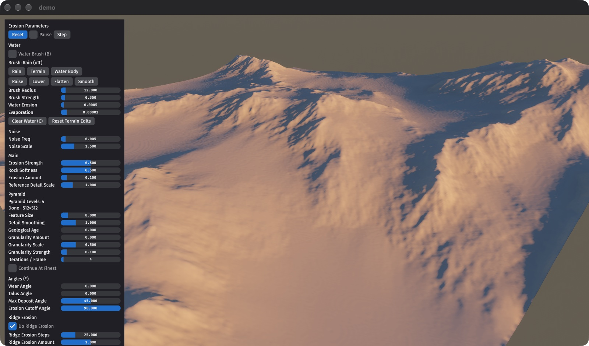

# Bevy Erosion

Real-time GPU-accelerated hydraulic erosion simulation built with Bevy.



Based on the Smooth Fluvial Erosion algorithm from Kruger Terrain Tools Houdini Asset.

https://samk9632.gumroad.com/l/KTTforHoudini

## Bevy compatibility

| bevy | bevy_erosion |
|------|--------------|
| 0.20 | main         |

## Features

- **Particle-based erosion simulation** running entirely on GPU compute shaders
- **Multiple visualization modes**:
  - PBR shading with atmospheric effects
  - Flow map (direction & magnitude)
  - Sediment deposition heat map
  - Erosion intensity visualization
  - Height contours
  - View-space normals
  - Curvature and age maps
  - River momentum, with Do Rivers on
- **Coarse-to-fine pyramid**: erodes at low resolution first, then refines level by level up to the full map
- **Interactive controls** for real-time simulation, plus a parameter panel built with Bevy Feathers (`ui` feature, on by default)
- **Brushes**: rain erosion trails onto the terrain, sculpt the source terrain (raise, lower, flatten, smooth), pour water that pools into lakes and runs off as rivers (shallow-water solver coupled to the erosion), or click to place a river with a carved bed
- **Water rendering**: lakes, rivers and the ocean are drawn by bevy_fft's water surface (refraction, foam) from a `WaterHeightfield` over the solver
- **Ocean**: optional sea level that drains water

## Controls

| Key | Action |
|-----|--------|
| `R` | Reset simulation |
| `Space` | Pause/Resume |
| `E` | Step one iteration (when paused) |
| `1` | PBR shading mode (default) |
| `2` | Flow map preview |
| `3` | Sediment mask preview |
| `4` | Erosion mask preview |
| `5` | Height map preview |
| `6` | View-space normals preview |
| `7` | Curvature map preview |
| `8` | Age map preview |
| `9` | Simple shading (no atmosphere or water optics) |
| `0` | River momentum preview (Do Rivers) |
| `B` | Toggle the brush (left drag paints, Shift + drag erases, right drag orbits) |
| `V` | Cycle brush: rain / terrain / water body / river |
| `T` | Cycle terrain tool: raise / lower / flatten / smooth |
| `[` / `]` | Shrink / grow the brush |
| `C` | Clear water |
| `X` | Reset terrain edits |
| `G` | Shape beds: cut channels sized by their discharge, and lake bowls, under the current water |
| `M` | Refine beds: run the bed load under the current flow for Refine hours, sped up |

## Units

The map has a physical size: `EROSION_METRES_PER_TEXEL` (default 10 m, a 5 km map) sets the
texel size, and the scene is drawn at that scale, so the atmosphere, shadows and water optics see
real distances. Heights are isotropic with the grid (100 texels per height unit: 1 km of relief
at 10 m texels). The panel shows lengths, depths and wavelengths in metres, rain and
infiltration in mm/h, discharge in m³/s and grain size in mm.

The water runs in seconds with real gravity, Manning roughness in s/m^⅓ and a time step set by
the CFL condition; Time Scale sets how many simulated seconds pass per second. Bed load follows
Wong & Parker (2006) for the grain size. River channels come from one model: a catchment of
A km² carries a bankfull Q = k·A^0.8 m³/s in a channel 4.4·Q^0.5 m wide and 0.3·Q^0.4 m deep.
The Drainage view shows the catchment of every texel. See `docs/UNIFIED_PLAN.md`.

## River brush

With the River brush, a click on the terrain places a river. A preview line shows where it will
run before you click.

- **Route:** from the click it runs down the eroded terrain's valleys until it reaches the sea,
  standing water, another river or the map edge. It fills any hollow on the way and leaves over
  its lowest rim.
- **Bed:** cut into the terrain, sized by the bankfull discharge along it: that of its
  drainage area plus the Upstream Catchment, through the channel model (Lake & River Beds), with
  Shape Beds' profile and bank grading. Steep reaches get step-pools, gentler ones riffle-pools,
  and bends get point bars.
- **Water:** a spring at the source keeps it flowing.

| Setting | Effect |
|---|---|
| Upstream Catchment | Area (km²) draining into the next river beyond what the map drains to it: rivers from off the map or from a larger range |
| Armour | How much of the bed the water may rework. 1 keeps every step up and every pool open; 0 lets the water erosion, slumping and bed load wear the steps down and fill the pools. |
| Bed Detail | Strength of the steps, pools and point bars |
| Breach Depth | Highest rise the bed cuts through; behind a higher one the water fills a lake and spills over |

Shift + click removes the rivers starting under the brush, and Clear Rivers removes them all.
Rivers survive reruns of the cascade: once it finishes, each one is carved again into the new
terrain along the same path, with the flows of the new drainage area.

## Boulders

With the Boulders brush, dragging drops boulders under the brush (Boulder Size, ±30 %), and
Shift + drag removes them. Each is a body on the GPU: the water's drag and lift, buoyancy and
gravity down the slope move it once they beat its friction (Coulomb, at rest the tangent of its
pivot angle), so the flow carries small boulders and leaves large ones, and boulders roll off
steep slopes. Each one adds a bump of its own volume to the shallow-water solver's bed (not to the
terrain), so the water piles up in front of it and speeds up past it. Clear Boulders removes them
all. Up to 4096 at a time.

| Setting | Effect |
|---|---|
| Boulder Size | Diameter (m) of the boulders the brush drops |
| Drag Coefficient | C_d on the frontal area in the flow |
| Friction | Tangent of the pivot angle: how hard a resting boulder is to set moving |

## Landslides

With the Landslide brush, a click releases a landslide under the brush: a slab 25 m deep at the
centre (thinning to the rim) leaves the terrain and runs as a granular flow (MPM, on the GPU, in a
640 m box around it at 10 m texels). It comes to rest at about its friction angle, and for a
minute of slide time the moving debris is part of the terrain, so the water flows over and
around it. What is left at the end is the deposit.

Slopes also fail on their own (Slopes Fail on Their Own, on by default): wherever a slab of the
slip depth has an infinite-slope factor of safety below 1, a slide releases there, one at a time.
Dry slopes hold to about 45°; slopes with water running over them fail from about 30°. Cohesion
is higher on hard rock (KTT's softness mask).

| Setting | Effect |
|---|---|
| Slip Depth | Depth (m) of the slab at the centre of a release |
| Debris Friction | Angle the debris comes to rest at |
| Basal Friction | Friction of the debris sliding on the terrain |
| Duration, Speed | Slide seconds per event, and per real second |
| Slope Friction, Cohesion | Strength of intact slopes in the stability check |

## Scenes

The Scenes tab of the panel plays scripted scenes that show the features, each with captions
and a camera that moves to the action. A scene first finds its sites on the eroded map: a river
source with a good catchment, a stretch of that river, and the steepest slope above it that
faces the river.

| Scene | What it shows |
|---|---|
| Full Tour | Everything below in turn (about 90 s) |
| Terrain & Drainage | The eroded terrain, and the drainage area that sizes its channels |
| River & Rain | A river placed at the source, then rain, the shallow-water solver and bed load |
| Boulders | Rocks dropped into the river, and the bed's boulder fraction |
| Landslide | The slope above the river lets go and runs into the valley; then slopes failing on their own |

Escape (or Stop) ends a scene and restores the view, rainfall and automatic landslides. The demo
plays the full tour on startup with `--showcase` (or `EROSION_SHOWCASE=1`), or one scene with
`EROSION_SHOWCASE=landslide`; `EROSION_SHOWCASE_SHOTS=<dir>` saves a screenshot halfway through
each stage and quits when it ends.

```bash
cargo run --release --example demo -- --showcase
```

## KTT rivers

**Do Rivers** turns on KTT's river momentum: every trail leaves momentum behind it, and where it
builds up, trails drop less of their load and the bed is cut further. Changing any erosion
slider reruns the cascade.

- **River Scale** sets how strongly the river terms act. At 0, with Trail Damping at 0, the
  terrain is the same as with Do Rivers off.
- **River Threshold** is the momentum below which a cell counts as hillslope, so the river
  terms only act in the channels. The `0` view shows the momentum.
- **Trail Damping** takes the trails' speed away everywhere but in the rivers, so they run
  straight downhill. 0 keeps the regular erosion and adds soft channels; 1 carves a dense
  dendritic network (KTT's own behaviour at Friction 1). The default is 0.3.

KTT applies uplift and river channeling once per pyramid level. Here they run every 20
iterations, each its share of the level, so channels show and feed back while a level runs.

## Running

```bash
cargo run --release --example demo
```

Without the parameter panel:

```bash
cargo run --release --example demo --no-default-features
```

For development use the file watcher feature for hot-reloading shaders:

```bash
cargo run --example demo --features=bevy/file_watcher
```

Shaders live in `assets/`. The compute passes are plain WGSL; the terrain material (`terrain_extended.wesl`) is WESL, since it imports `bevy_pbr` modules.
