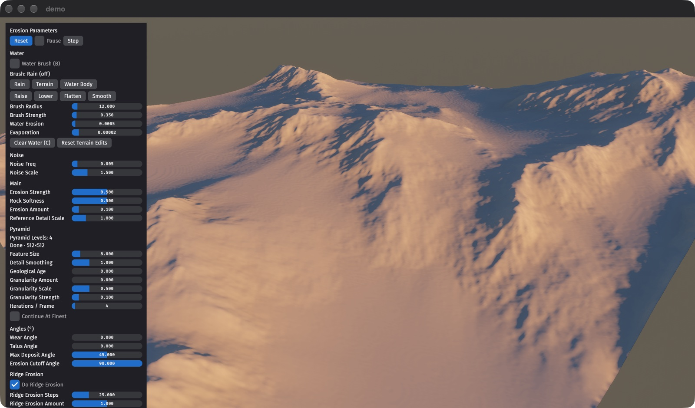

# Bevy Erosion

Real-time GPU-accelerated hydraulic erosion simulation built with Bevy.



Based on the Smooth Fluvial Erosion algorithm from Kruger Terrain Tools Houdini Asset.

https://samk9632.gumroad.com/l/KTTforHoudini

## Bevy compatibility

| bevy | bevy_erosion |
|------|--------------|
| 0.20 | main         |

## Features

- **Particle-based erosion simulation** running entirely on GPU compute shaders
- **Multiple visualization modes**:
  - PBR shading with atmospheric effects
  - Flow map (direction & magnitude)
  - Sediment deposition heat map
  - Erosion intensity visualization
  - Height contours
  - View-space normals
  - Curvature and age maps
  - River momentum, with Do Rivers on
- **Coarse-to-fine pyramid**: erodes at low resolution first, then refines level by level up to the full map
- **Interactive controls** for real-time simulation, plus a parameter panel built with Bevy Feathers (`ui` feature, on by default)
- **Brushes**: rain erosion trails onto the terrain, sculpt the source terrain (raise, lower, flatten, smooth), or pour water that pools into lakes and runs off as rivers (shallow-water solver coupled to the erosion)
- **Ocean**: optional sea level that renders flat and drains water

## Controls

| Key | Action |
|-----|--------|
| `R` | Reset simulation |
| `Space` | Pause/Resume |
| `E` | Step one iteration (when paused) |
| `1` | PBR shading mode (default) |
| `2` | Flow map preview |
| `3` | Sediment mask preview |
| `4` | Erosion mask preview |
| `5` | Height map preview |
| `6` | View-space normals preview |
| `7` | Curvature map preview |
| `8` | Age map preview |
| `9` | Simple shading (no atmosphere or water optics) |
| `0` | River momentum preview (Do Rivers) |
| `B` | Toggle the brush (left drag paints, Shift + drag erases, right drag orbits) |
| `V` | Cycle brush: rain / terrain / water body |
| `T` | Cycle terrain tool: raise / lower / flatten / smooth |
| `[` / `]` | Shrink / grow the brush |
| `C` | Clear water |
| `X` | Reset terrain edits |

## Rivers

**Do Rivers** turns on KTT's river momentum: every trail leaves momentum behind it, and where it
builds up, trails drop less of their load and the bed is cut further. Changing any erosion
slider reruns the cascade.

- **River Scale** sets how strongly the river terms act. At 0, with Trail Damping at 0, the
  terrain is the same as with Do Rivers off.
- **River Threshold** is the momentum below which a cell counts as hillslope, so the river
  terms only act in the channels. The `0` view shows the momentum.
- **Trail Damping** takes the trails' speed away everywhere but in the rivers, so they run
  straight downhill. 0 keeps the regular erosion and adds soft channels; 1 carves a dense
  dendritic network (KTT's own behaviour at Friction 1). The default is 0.3.

KTT applies uplift and river channeling once per pyramid level. Here they run every 20
iterations, each its share of the level, so channels show and feed back while a level runs.

## Running

```bash
cargo run --release --example demo
```

Without the parameter panel:

```bash
cargo run --release --example demo --no-default-features
```

For development use the file watcher feature for hot-reloading shaders:

```bash
cargo run --example demo --features=bevy/file_watcher
```

Shaders live in `assets/`. The compute passes are plain WGSL; the terrain material (`terrain_extended.wesl`) is WESL, since it imports `bevy_pbr` modules.
